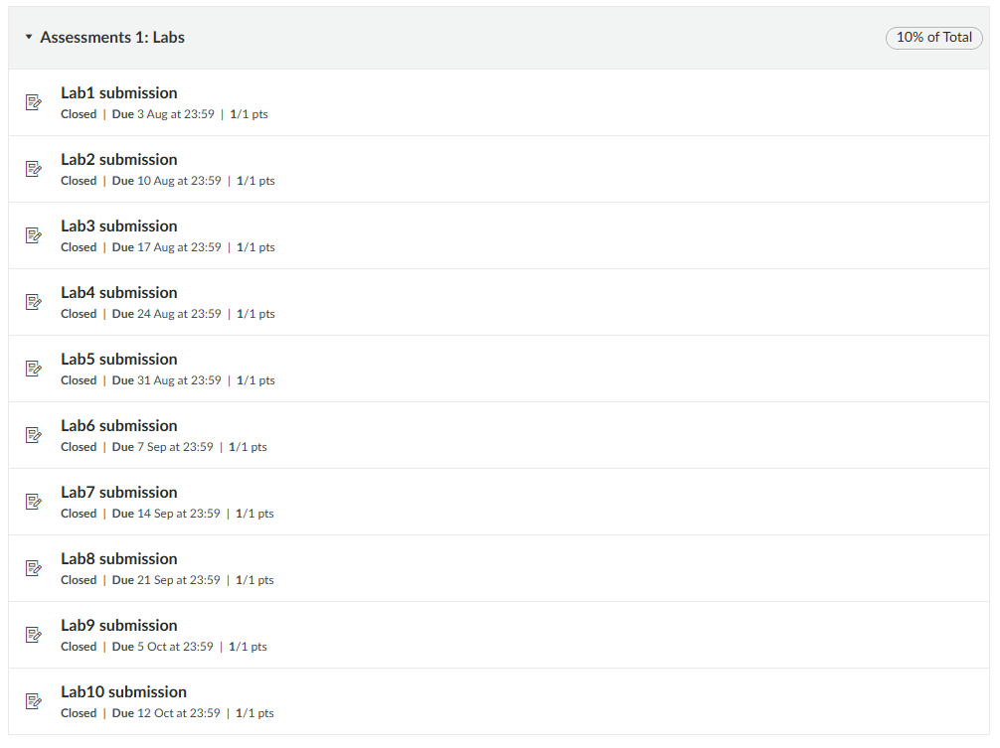
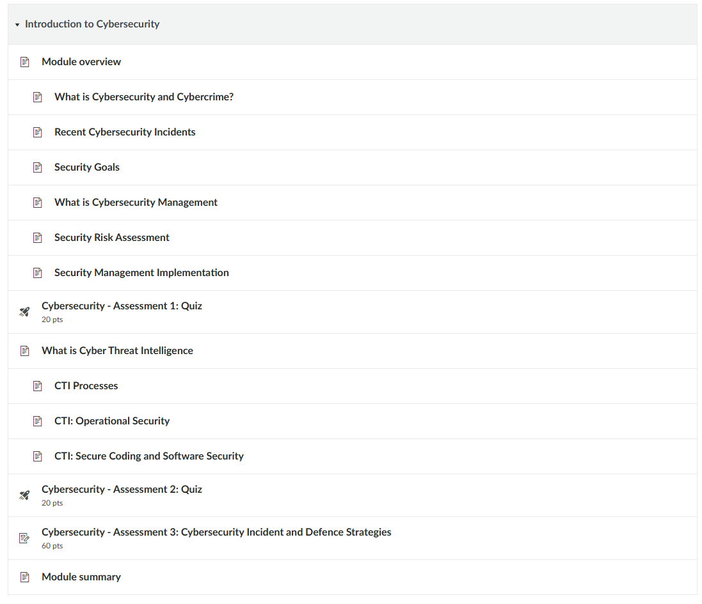
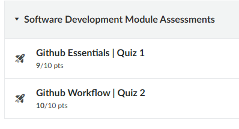

# PPC Portfolio Evidence Repository
**Name:** Kai Jennings  
**Student ID:** 25907104  
---

## Overview
This document serves as the index for all evidence associated with my Professional Learning Plan (PLP) goals for this semester.

---

## 1. Goal 2: Foundational Cybersecurity
**Focus:** Routing, switching, underlying network infrastructure, server architecture, and port security.

### Artefacts & Documentation
* **Completed Coursework:**
  
 

---

## 2. Goal 3: Software Development
**Focus:** Theory of Computer Science, parser generation, automata/Turing machines, and open-source contributions.

### Artefacts & Documentation
* **Language-Agnostic Parser Generator:**
  * Repository Link: https://github.com/Kai-Jennings/ToC
* **Turing Machine Program:**
  * Repository Link: https://github.com/Kai-Jennings/ToC/tree/main/toc2
* **Open-Source Contributions:**
  * Project: **Desmodder**
    * Repository Link: https://github.com/DesModder/DesModder
  * Project: **Ambavia** 
    * Repository: https://github.com/fadaaszhi/ambavia
  * University Canvas Modules & GitHub Quizzes:
    
    

---

## 3. Goal 4: Numerical Analysis
**Focus:** Recreational mathematics, Galois field error correction, QR code generation, and competitive programming.

### Artefacts & Documentation
* **Desmos QR Code Generator:**
  * Graph Link: https://www.desmos.com/calculator/hnpa2qbgad
* **ProgSoc Competitive Programming Event:**
  * Result: 4th place by 1 point
